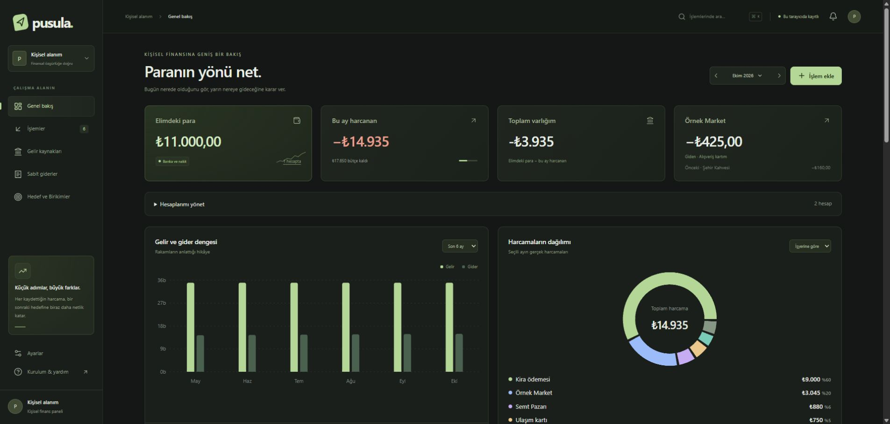
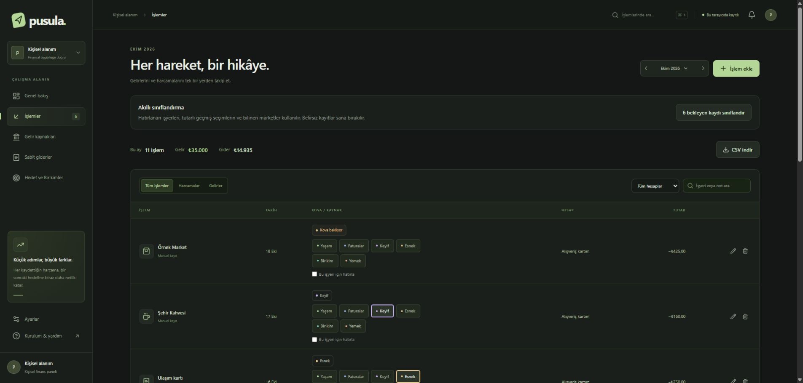
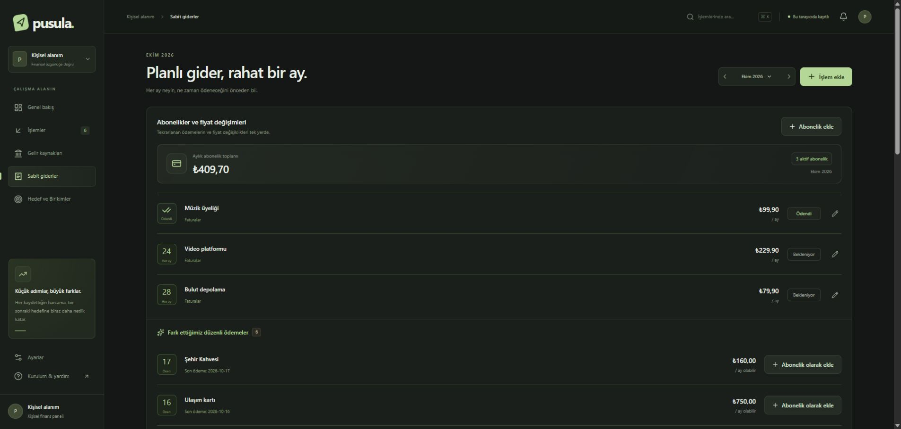
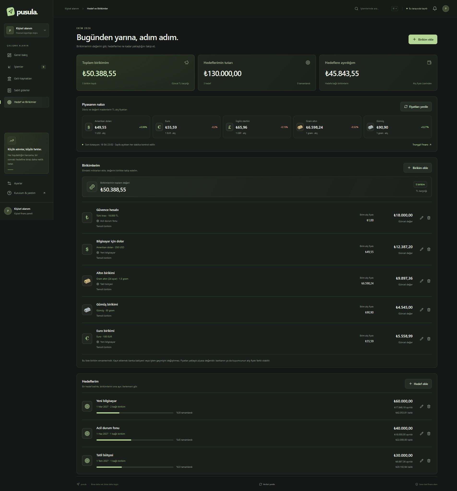

# Pusula — Boş başlangıç sürümü

Pusula; gelirlerini, harcamalarını, hesaplarını, aboneliklerini ve birikim hedeflerini tek yerde takip edebileceğin Türkçe bir kişisel finans panelidir. Next.js, React, TypeScript ve Recharts ile hazırlanmıştır.

**Bu paket, kendi bilgisayarında tarayıcıdan açılan bir web uygulamasıdır.** Çalıştırmak için önce Node.js kurulur, proje dosyaları indirilir ve aşağıdaki iki komut kullanılır. Kurulum tamamlandığında paneli tarayıcından kullanırsın. Şifre, API anahtarı, Supabase hesabı veya ücretli hizmet gerekmez.

Başlangıç sürümü **boştur**: kişisel hesap, işlem, hedef, birikim veya bağlı bulut hesabı içermez. Görsellerdeki örnek kayıtlar sana otomatik eklenmez.

[Kurulum](#kurulum-adım-adım) · [Tekrar açma ve kapatma](#uygulamayı-kapatma-ve-tekrar-açma) · [İlk kullanım](#i̇lk-kullanım) · [Sorun giderme](#sık-karşılaşılan-sorunlar) · [Ekran görüntüleri](#uygulamadan-görüntüler)

## Kurulum: adım adım

Aşağıdaki anlatım Windows içindir. Git veya kod düzenleyici kurman gerekmez. İnternet bağlantısı ilk kurulumda paketleri indirmek ve kullanım sırasında döviz/maden fiyatlarını almak için gerekir.

### 1. Node.js 24'ü kur

1. [Node.js'in resmi indirme sayfasını](https://nodejs.org/en/download) aç.
2. **24.x LTS** sürümünü ve işletim sistemine uygun kurulum dosyasını seç. Windows için bu genellikle **Windows Installer (.msi)** dosyasıdır.
3. İndirdiğin dosyayı çalıştır ve kurulumu tamamla. Varsayılan seçenekler yeterlidir; **npm** bileşeni de kurulu olmalıdır.
4. Önceden açık komut pencerelerin varsa kapat; sonraki adımlarda yeni bir pencere aç.

Node.js, paneli bilgisayarında çalıştıran altyapıdır. npm ise panelin ihtiyaç duyduğu paketleri indirir; Node.js ile birlikte gelir. Bu kurulum bilgisayar başına bir kez yapılır.

### 2. Başlangıç paketini indir ve ZIP'ten çıkar

1. [En güncel sürümün Releases sayfasını](https://github.com/UtkuAkaln/pusula-finans-starter/releases/latest) aç.
2. **Assets** bölümündeki **`pusula-finans-starter-v1.0.0.zip`** dosyasını indir.
3. ZIP dosyasına sağ tıkla → **Tümünü ayıkla** → **Ayıkla**. Örneğin Masaüstü'nde bir klasöre çıkarabilirsin.
4. Çıkan klasörleri açarak içinde **`package.json`**, **`package-lock.json`** ve **`README.md`** dosyalarının birlikte bulunduğu klasöre gir. Komutları bu klasörde çalıştıracağız.

ZIP'in içinden çalıştırma; önce dosyaları ayıkla. GitHub'daki **Code → Download ZIP** seçeneği de kullanılabilir; bu durumda da `package.json` dosyasının bulunduğu klasörü açmalısın. Depo özelse, indirmek için erişim izni olan GitHub hesabınla oturum açman gerekir.

### 3. Doğru klasörde bir komut penceresi aç

Dosya Gezgini'nde, az önce bulduğun **`package.json` dosyasının bulunduğu klasör açıkken**:

1. Pencerenin üstündeki klasör adres çubuğuna tıkla.
2. Adresin yerine **`cmd`** yaz ve **Enter** tuşuna bas.
3. Siyah bir Komut İstemi penceresi açılır. Bu pencere zaten doğru proje klasöründedir; ayrıca klasör değiştirmene gerek yoktur.

Aşağıdaki komutu kopyalayıp pencereye yapıştır ve Enter'a bas:

```bat
node --version
```

`v24.` ile başlayan bir sonuç görmelisin. Ardından şunu çalıştır:

```bat
npm --version
```

Burada da bir sürüm numarası görünmelidir. Bir komut tanınmıyorsa aşağıdaki sorun giderme bölümünü kullan.

### 4. Gerekli paketleri indir — ilk kurulumda

Aynı komut penceresinde şu komutu çalıştır:

```bat
npm ci
```

Bu komut projenin ihtiyaç duyduğu paketleri **`node_modules`** klasörüne indirir. Bağlantına göre birkaç dakika sürebilir. İşlem tamamlanıp klasör yolu yeniden göründüğünde sonraki adıma geç. Bu komutu her açışta çalıştırman gerekmez; yeni bir sürümü ayrı klasöre indirdiğinde tekrar gerekir.

### 5. Paneli başlat

Aynı pencerede şu komutu çalıştır:

```bat
npm run dev
```

Pencerede **`Ready`** ve **`http://127.0.0.1:3000`** adresini gördüğünde panel hazırdır. **Bu pencereyi açık bırak.** Komutun çalışmaya devam etmesi normaldir; paneli açık tutan bu penceredir.

### 6. Tarayıcıdan aç

Chrome, Edge, Brave veya Firefox gibi bir tarayıcı aç. Adres çubuğuna aşağıdaki adresi yazıp Enter'a bas:

**[http://127.0.0.1:3000](http://127.0.0.1:3000)**

İlk sayfanın hazırlanması biraz sürebilir. Açıldığında boş Pusula panelini göreceksin; giriş şifresi istenmez. Bu adres kendi bilgisayarını gösterir; başka bir bilgisayarda aynı adresi açmak senin paneline erişim sağlamaz.

macOS veya Linux kullanıyorsan Node.js 24 kurup ZIP'i çıkardıktan sonra Terminal'i `package.json` bulunan klasörde aç. Sırasıyla `npm ci` ve `npm run dev` komutlarını çalıştır; ardından aynı tarayıcı adresini aç.

## Uygulamayı kapatma ve tekrar açma

**Kapatmak için:** komut penceresinde **Ctrl + C** tuşlarına bas. Windows işlemi sonlandırmayı sorarsa onayla. Tarayıcı sekmesini kapatmak tek başına sunucuyu durdurmaz.

**Başka bir gün tekrar açmak için:** proje klasöründe 3. adımdaki gibi komut penceresini aç, yalnızca aşağıdaki komutu çalıştır ve tarayıcıdaki adresi aç:

```bat
npm run dev
```

Node.js'i yeniden kurmana veya `npm ci` komutunu her seferinde çalıştırmana gerek yoktur. Kayıtlarının görünmesi için **aynı tarayıcı profilini ve aynı adresi** kullan: `localhost` ile `127.0.0.1` veya farklı portlar ayrı kayıt alanlarıdır. Komut penceresini kapatmak kayıtlarını silmez.

## İlk kullanım

İlk açılışta hesaplar ve işlemler boştur; yalnızca düzenleyebileceğin genel bütçe kovaları bulunur.

1. **Bir hesap ekle:** Genel bakış → **Hesaplarımı yönet** → **Hesap ekle**. Hesabına bir ad ver, banka/hesap türünü seç ve başlangıç bakiyeni gir.
2. **İlk harcamanı gir:** **İşlem ekle** düğmesine bas. Harcama yönünü, açıklamayı, tutarı, tarihi ve hesabı seç.
3. **Kovasını seç:** İşlemler sayfasında ilgili satırdaki Yaşam, Faturalar, Keyif, Esnek, Birikim veya Yemek düğmelerinden uygun olanına bas.
4. **Düzenli kayıtlarını oluştur:** Gelir kaynaklarında beklenen gelirleri; Sabit giderlerde abonelik, kira veya faturaları ekle. Aylık ve haftalık seçenekleri bulunur. Beklenen kaydı oluşturmak tek başına gerçekleşmiş bir banka işlemi eklemez.
5. **Hedef ve birikim ekle:** Hedef ve Birikimler sayfasından hedef tutarını, sonra elindeki TL/döviz/maden miktarını gir. Birikimi hedefe bağlayarak ilerlemeyi görebilirsin.
6. **Özelleştir:** Ayarlar bölümünden kova adlarını, oranlarını ve renklerini değiştir. İşlemler sayfasındaki **CSV indir** düğmesi işlem listesini dışa aktarır; tüm uygulamanın geri yüklenebilir yedeği değildir.

## Sık karşılaşılan sorunlar

| Gördüğün durum | Yapılacak işlem |
| --- | --- |
| `node` veya `npm` tanınmıyor | Node.js 24 kurulumunu tamamla. Eski komut penceresini kapatıp yeni bir pencere aç; `node --version` ile tekrar kontrol et. |
| PowerShell, `npm.ps1` çalıştırılamıyor diyor | 3. adımdaki gibi `cmd` aç veya PowerShell'de komutları `npm.cmd ci` ve `npm.cmd run dev` şeklinde yaz. |
| `package.json` bulunamadı / `ENOENT` | Komutu yanlış klasörde çalıştırıyorsun. `package.json` dosyasının göründüğü klasörü açıp adres çubuğundan yeniden `cmd` başlat. |
| Paket kurulumu ağ hatasıyla durdu | İnternet bağlantını kontrol et; aynı proje klasöründe `npm ci` komutunu yeniden çalıştır. |
| 3000 portu kullanımda | Terminal başka bir adres verdiyse onu aç. İstersen `npm run dev -- --port 3001` ile başlatıp `http://127.0.0.1:3001` adresini kullan. Farklı portun kayıt alanı da ayrıdır. |
| Tarayıcı “siteye ulaşılamıyor” diyor | Komut penceresi açık mı ve `Ready` yazıyor mu kontrol et. `npm run dev` ile yeniden başlat; terminalde yazan adresi aç. |
| Panel açıldı ama kayıtlarım yok | Aynı tarayıcı profili ve aynı adres/portu kullandığını kontrol et. Gizli pencere veya farklı tarayıcı ayrı kayıt alanıdır. Tarayıcı verileri silindiyse kayıtlar geri gelmez. |
| Döviz veya maden fiyatı gelmiyor | İnternet bağlantısını ve sayfadaki fiyat/kotasyon durumunu kontrol et. Fiyat sağlayıcısındaki kesinti, yerel işlem kayıtlarını silmez. |
| İndirme bağlantısı 404 gösteriyor | Depo özel olabilir. Erişim verilen GitHub hesabınla oturum aç; gerekiyorsa depo sahibinden erişim iste. |

## Uygulamadan görüntüler

Aşağıdaki ekran görüntüleri uygulamanın ayrı bir yerel önizlemesinde, **tamamen temsili hesap, işlem ve birikim kayıtlarıyla** hazırlanmıştır. Gerçek kişisel veri içermezler. Bu örnek kayıtlar başlangıç sürümüne eklenmez; uygulama ilk açılışta boş gelir. Görsellerdeki piyasa fiyatları çekim anına aittir.

### Genel bakış — paranın yönünü gör



Elindeki para, bu ayki harcama, kalan toplam ve son işlem tek ekranda görünür. Yan yana duran gelir–gider ve donut grafiklerle aylık hareketleri karşılaştırabilir; harcamaların dağılımını işyerine veya kovaya göre inceleyebilirsin. Hesaplarını aynı sayfadaki açılır bölümden yönetebilirsin.

### İşlemler — harcamalarını kolayca düzenle



Gelir ve harcamaları ara, hesaba göre filtrele ve her harcamanın kovasını doğrudan satırından seç. **Bu işyeri için hatırla** seçeneği sonraki sınıflandırmalara yardımcı olur; işlem listesini CSV olarak dışa aktarabilirsin.

### Sabit giderler — aboneliklerini ve ödeme günlerini takip et



Aboneliklerin aylık toplamını, ödeme günlerini ve ödendi/bekleniyor durumlarını tema ile uyumlu kartlarda gör. Aynı sayfanın **Aylık düzenin** bölümünde aylık veya haftalık giderleri planlayabilir, yapılan ödemeleri işlemlerle eşleştirebilirsin. Tekrarlanan ödemelerden çıkarılan abonelik önerileri onayınla kayda dönüşür.

### Hedef ve Birikimler — birikimlerini hedeflerine bağla



TL, dolar, euro, sterlin, altın ve gümüş miktarlarını kaydet; piyasa alış fiyatlarıyla yaklaşık TL karşılıklarını takip et. Birikimlerini bir hedefe ayırdığında hedef tutarı, ayrılan miktar, kalan tutar ve ilerleme oranı birlikte gösterilir. Fiyat kaynağı ve son kotasyon zamanı da ekranda yer alır.

## Veriler nerede?

Kayıtlar tarayıcıdaki `localStorage` alanında tutulur. Sunucuya, GitHub'a veya bir bulut veritabanına gönderilmez. Her tarayıcının/alan adının verisi ayrıdır. Tarayıcı verilerini temizlemek kayıtları siler; işlem listesini CSV olarak dışa aktarabilirsiniz. Paylaşılan bilgisayarda aynı tarayıcı profilini kullanan kişiler bu kayıtlara erişebilir.

Bu sürümde Supabase, Gmail, Telegram, Gemini veya kişisel Vercel bağlantısı bulunmaz. Sunucuda finans verisi okuyan/yazan API ve giriş ekranı yoktur. `api/market` yalnızca herkese açık piyasa kotasyonlarını getirir.

## Piyasa fiyatları

[Trunçgil Finans](https://finans.truncgil.com/) üzerinden dolar, euro, sterlin, altın ve gümüş alış fiyatları alınır. Sayfa görünürken yaklaşık dakikada bir kontrol edilir; kaynağın kotasyon zamanı gösterilir. Kaynakta gecikme veya kesinti olursa bu durum belirtilir, mevcut sunucu sürecindeki son fiyatlar korunur. Değerler yaklaşık piyasa karşılığıdır; banka/kuyumcu fiyatları farklı olabilir. Kişisel kayıtlar fiyat sağlayıcısına iletilmez.

## Geliştiriciler için: doğrulama ve üretim çalıştırması

Günlük yerel kullanım için yukarıdaki `npm run dev` yeterlidir. Kaynak kodu değiştirdiysen test ve tip kontrolünü çalıştırabilirsin:

```sh
npm test
npm run typecheck
```

Üretim modunda denemek veya sunucuda çalıştırmak için önce çalışan geliştirme sunucusunu durdur; sonra proje klasöründe sırasıyla şu komutları çalıştır:

```sh
npm run build
npm start
```

`npm start` için önceden başarılı bir `npm run build` gerekir. Bu komutlar tek başına uygulamayı internete yayımlamaz; sunucu açıkken terminalde gösterilen yerel adresten kullanabilirsin.

Herhangi bir Next.js barındırıcısında çalıştırılabilir. Giriş ekranı gerekmez; finans verileri her ziyaretçinin kendi tarayıcısında kalır. `.env*`, derleme çıktıları ve yerel veri/yedek dosyaları Git'e dahil edilmez. README için hazırlanmış temsili ekran görüntüleri `docs/images/` içinde sürümlenir; kişisel ekran görüntüleri depoya eklenmemelidir.

## Görseller

Banka amblemlerinin kaynakları `public/brand/banks/SOURCES.md` dosyasında belirtilmiştir. Pusula simgesi ve koyu yeşil tema projeyle birlikte gelir.
